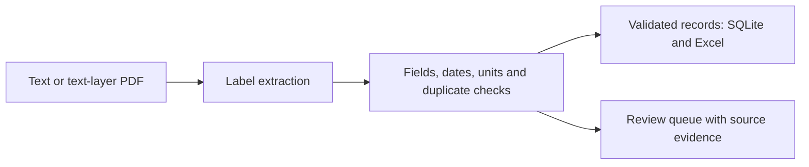

# Concrete Ticket Parser

[](https://github.com/TusharSrivastava751/concrete-ticket-parser/actions/workflows/tests.yml)

> **Public reconstruction based on a CV project concept.** New implementation prepared
> with AI assistance, using only synthetic data. Original workplace code and datasets
> were not available. See [provenance](PROVENANCE.md). This demo does not substantiate
> historical productivity savings or production performance.

Turn a labelled concrete delivery ticket into traceable records for SQL and Excel,
while keeping uncertain inputs in a review queue.

The CV project describes a Python/HTML pipeline for delivery-note and concrete-report
PDFs. This public version demonstrates **delivery tickets only**, a local review page,
and auditable exports. It does not parse laboratory report tables or arbitrary layouts.



## What you can inspect

- Known label aliases, line evidence and a SHA-256 source fingerprint.
- ISO dates; positive quantities with explicit m³ or litre units.
- Duplicate supplier/ticket IDs quarantine **all copies in the input batch**.
- Parameterised SQL and text-safe Excel cells, including strings beginning with `=`.
- HTML batch report and a local Python/HTML page for pasted ticket text.

## Run locally

Use Python 3.11 or newer. Download this repository with **Code → Download ZIP** and
extract it. Open a terminal in the extracted folder. On macOS/Linux, use `python3`
if `python` is unavailable.

```bash
python -m venv .venv
# macOS / Linux:
source .venv/bin/activate
# Windows PowerShell instead:
# .venv\Scripts\Activate.ps1
python -m pip install -r requirements.txt
```

The direct dependencies are pinned. Transitive packages are resolved by pip; this is
not a fully locked environment. No API key, paid model or network call is needed once
dependencies are installed. Use a **new output directory** for each run.

```bash
python ticket_parser.py examples/ticket-001.txt examples/ticket-002.txt examples/ticket-review.txt --out reports
python -m unittest discover -s tests -v
```

Expected result: **2 validated; 1 for review; 14.000 m³ validated volume**.
Open `reports/report.html`, `reports/tickets.xlsx` or `reports/audit.json`.
The SQLite database is `reports/tickets.sqlite`; its `tickets` table contains only
validated records. Excel has a separate review queue. Outputs are fresh batch
snapshots; reimporting batches into another system needs persistent deduplication.

[Checked example report](examples/expected/report.html) ·
[Field-level audit](examples/expected/audit.json)

### Try PDF input

```bash
python make_demo_pdf.py
python ticket_parser.py examples/demo-ticket.pdf --out reports-pdf
```

This generates a text-layer PDF from the included fictional ticket. It is a fixture
generator, not a general PDF authoring tool. Do not feed both the PDF and the same
TXT ticket into one batch unless you want to exercise duplicate detection.

### Open the local review page

```bash
python app.py
```

Open <http://127.0.0.1:8766>, edit the sample and select **Check ticket**. The page
does not save pasted text. Use synthetic inputs. Stop the local server with Ctrl+C.

## Input contract and limits

One ticket per file, one labelled field per line: `Ticket No`, `Delivery Date`,
`Supplier`, `Site`, `Mix`, `Quantity`. See the examples for aliases. Required dates
use `YYYY-MM-DD`; quantities use a decimal point and explicit units. Repeated labels
are ambiguous even if their values agree. Mix references are retained as text and
are not checked against a specification or order.

This is a deterministic parser, **not an AI/OCR model**. Scanned image-only PDFs need
OCR and human verification. Complex tables, broken reading order, handwritten marks,
multiple tickets, thousand separators and arbitrary supplier layouts are unsupported.
Validation only means the supported fields passed these checks, not that a delivery
occurred or its record is correct. Review before importing into project systems.

## Tests and review exercise

Tests cover litre conversion, missing/duplicate fields, impossible dates, missing
units, duplicate tickets, actual PDF extraction, image-only/blank PDF review, SQL/
Excel reconciliation, formula-safe text, output overwrite refusal and CLI behaviour.
Change the sample quantity to `8` without a unit: explain why it must remain out of
the validated quantity total. Add one real supplier layout only after creating a
fully synthetic equivalent and explicit validation rules.

## References

- [pypdf text extraction](https://pypdf.readthedocs.io/en/stable/user/extract-text.html)
- [openpyxl workbook tutorial](https://openpyxl.readthedocs.io/en/3.1/tutorial.html)
- [Python sqlite3](https://docs.python.org/3/library/sqlite3.html)

MIT licensed. No employer/client documents are included.
